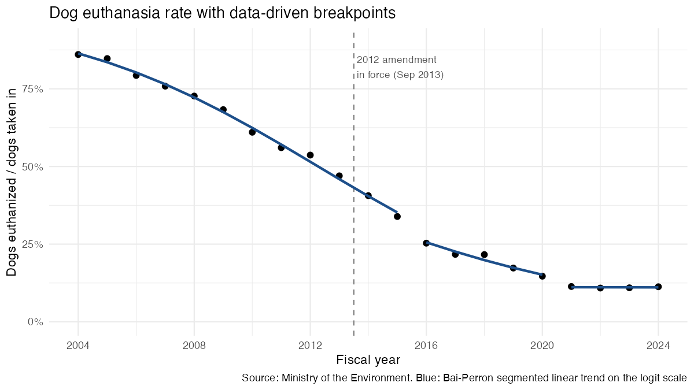
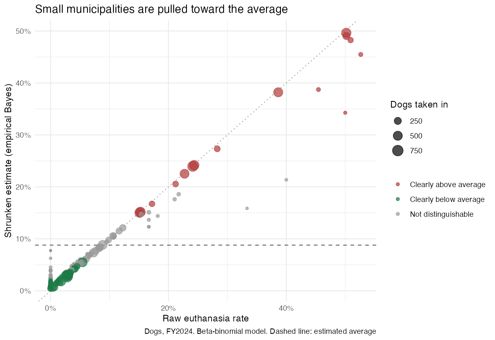

```{r}
#| label: setup
library(dplyr); library(readr); library(scales); library(here)
QUIET <- TRUE
source(here("R/02_models.R"))   # fits all models, writes output/*.csv and output/*.png
g13 <- glmb |> filter(break_from == 2013)
g21 <- glmb |> filter(break_from == 2021)
c13 <- chow |> filter(break_from == 2013)
ret_cor <- cor(mun$returned / mun$intake_total, mun$adopted / mun$intake_total)
```

All figures are computed from the Ministry of the Environment's published tables (see `data/SOURCES.md`). No survey or interview data are used here.

## RQ1. Did the decline change around the 2012 amendment?

The amended Animal Welfare Act (in force September 2013) allowed municipalities to refuse to take in dogs from owners. If the law changed outcomes, we would expect the **slope** of the euthanasia rate to change around FY2013.

Method. Let $r_t$ = dogs euthanized / dogs taken in, year $t$. I model $\operatorname{logit}(r_t)$ as a piecewise linear trend and test for a break in intercept and slope:

1. **Pre-specified break (FY2013, FY2014, FY2021):** Chow test on the logit rate, and an F-test between quasi-binomial GLMs with and without a break (the quasi-binomial accounts for overdispersion, φ ≈ `r round(g13$dispersion)`).
2. **Data-driven breaks:** Bai–Perron with a minimum segment of 4 years, number of breaks chosen by BIC.



```{r}
#| label: tbl-rq1
rq1 |>
  filter(!is.na(break_from)) |>
  transmute(Test = test, `Break from FY` = break_from, F = round(F, 2),
            p = signif(p_value, 2),
            `Slope before (logit/yr)` = round(slope_before, 3),
            `Slope after (logit/yr)` = round(slope_after, 3)) |>
  knitr::kable(caption = "Break tests for the national dog euthanasia rate, FY2004–2024")
```

**Findings.**

- **No clear break at FY2013.** The quasi-binomial test gives p = `r signif(g13$p_value, 2)`; the slope is about `r round(g13$slope_before, 2)` per year before and `r round(g13$slope_after, 2)` after. The decline was already under way at the same pace before the law. (The OLS Chow test is borderline, p = `r signif(c13$p_value, 2)`.)
- **A clear break at FY2021: the decline stops.** The slope after FY2021 is `r round(g21$slope_after, 3)` per year (≈ flat), p = `r signif(g21$p_value, 2)`. Bai–Perron, using no prior information, also finds `r n_break` breaks (from FY`r paste(break_years + 1, collapse = " and FY")`).
- Interpretation: the 2012 amendment does not show up as a change in the *rate*. The national rate has stayed at about 11% for four years. The rest of the data (FY2024: ① 74%, ② 6%, ③ 20%) suggests the remaining euthanasia is mostly dogs judged unsuitable for adoption, not dogs without adopters.

**Caveats.** n = 21 yearly points, with autocorrelation, so p-values are approximate. The law also changed the **denominator** (fewer owner surrenders accepted), which a rate cannot show; dogs refused at intake are not counted anywhere in this data. The FY2021 break sits at the edge allowed by the 4-year minimum segment.

## RQ2. How much do municipalities really differ?

### Why the adoption rate is the wrong measure

In EDA 01, I compared adoption rates (adopted / intake). In FY2024 the correlation between a municipality's **return rate** and its adoption rate is `r round(ret_cor, 2)`. A municipality that returns most stray dogs to their owners looks like a "low-adoption" municipality, even though returning a lost dog is a good outcome. So I use two measures that do not penalise returns:

- **Euthanasia rate** = euthanized / taken in
- **Rehoming share** = adopted / (adopted + euthanized): among dogs that left the shelter but were not returned, the share that were adopted

### Beta-binomial model

Each municipality $i$ has its own true rate $p_i$, drawn from a Beta distribution with mean $\mu$ and intra-class correlation $\rho$:

$$y_i \mid p_i \sim \text{Binomial}(n_i, p_i), \qquad p_i \sim \text{Beta}(\alpha, \beta), \quad \mu = \tfrac{\alpha}{\alpha+\beta},\ \rho = \tfrac{1}{\alpha+\beta+1}.$$

The **empirical Bayes** estimate $(\alpha + y_i)/(\alpha+\beta+n_i)$ pulls small municipalities toward $\mu$, which avoids ranking a municipality that took in 7 dogs as "best" or "worst" by chance. A municipality is flagged only if its 95% posterior interval excludes $\mu$.

```{r}
#| label: tbl-rq2-summary
rq2_summary |>
  transmute(Measure = outcome, `Average (μ)` = percent(mu, 0.1), `ρ` = round(rho, 3),
            `Clearly above` = n_high, `Clearly below` = n_low,
            `Type explains? (LRT p)` = signif(p_type, 2)) |>
  knitr::kable(caption = "Beta-binomial fits, dogs, FY2024 (129 municipalities)")
```



```{r}
#| label: tbl-rq2-high
r_euth$est |>
  filter(flag == "Clearly above average") |>
  transmute(Municipality = jurisdiction, `Dogs taken in` = n,
            `Raw rate` = percent(raw_rate, 1), `EB estimate` = percent(eb_rate, 1),
            `95% interval` = paste0(percent(lo95, 1), "–", percent(hi95, 1))) |>
  knitr::kable(caption = "Municipalities with a euthanasia rate clearly above the average")
```

**Findings.**

- Variation is real: ρ = `r round(r_euth$rho, 2)` for the euthanasia rate. Even after shrinkage, `r rq2_summary$n_high[1]` municipalities are clearly above the average (`r percent(r_euth$mu, 0.1)`), and `r rq2_summary$n_low[1]` are clearly below.
- The high-euthanasia group is concentrated: 徳島県, 愛媛県, 兵庫県 and 長崎県 are at about 38–50% even after shrinkage. The same municipalities also have the lowest rehoming shares.
- Municipality **type** (prefecture / designated city / core city) explains part of the variation (likelihood-ratio test p = `r signif(rq2_summary$p_type[1], 2)` for the euthanasia rate), but most of the spread is within types.
- Several high-adoption cases from EDA 01 hold up under the fairer measure: 倉敷市, 山口県, 広島県 and 茨城県 rehome over 96% of non-returned dogs.

**What the model cannot say.** Why the municipalities differ (intake mix, the share of dogs judged unsuitable under category ①, partnerships with rescue groups, shelter capacity). These are the questions in the shelter survey.

## Next steps

1. Model category ① separately from ② (RQ4): is the high-euthanasia group driven by the "unsuitable for adoption" judgement?
2. Add FY2022–2023 municipal tables to check whether the flagged municipalities are stable across years.
3. Join survey responses (when they arrive) to these estimates. Survey answers are kept separate from public data and never published at the organisation level.
