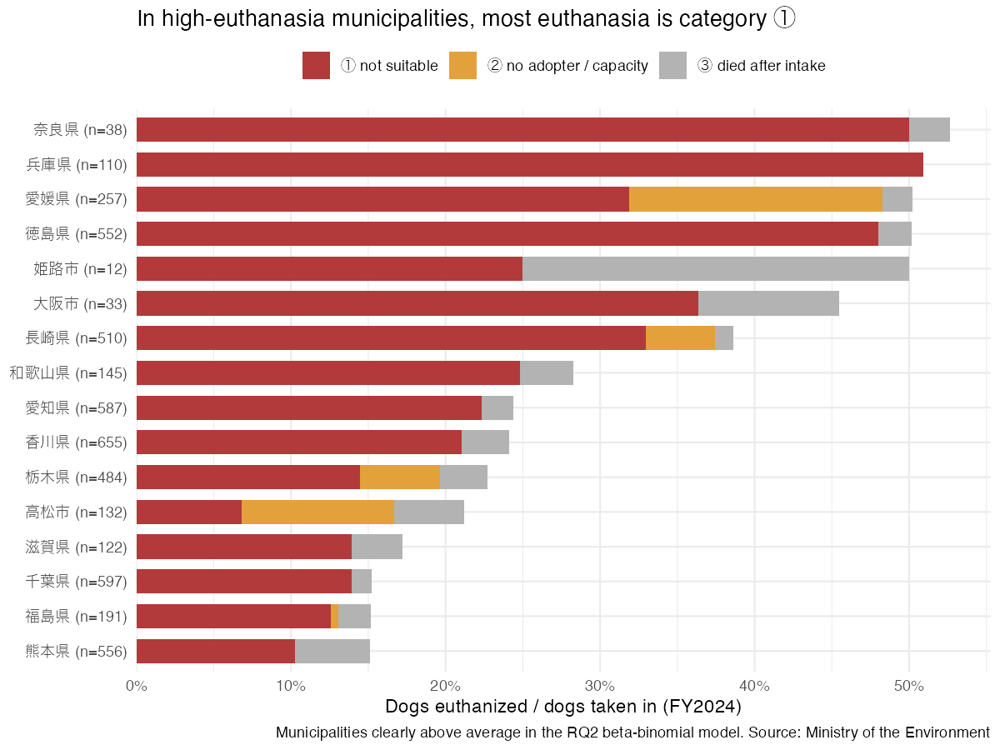

```{r}
#| label: setup
library(dplyr); library(readr); library(scales); library(here)
QUIET <- TRUE
if (!file.exists(here("output/rq2_betabinom_estimates.csv"))) source(here("R/02_models.R"))
source(here("R/03_rq4.R"))
hg <- by_group |> filter(flag == "Clearly above average")
lg <- by_group |> filter(flag == "Clearly below average")
pup <- high |> filter(euthanized_1_young > 0) |> arrange(desc(euthanized_1_young))
reg <- function(t) coefs |> filter(term == t)
```

All figures come from the Ministry of the Environment's FY2024 municipal tables (dogs only). No survey data are used.

## The three categories

Since FY2019, municipalities report euthanasia in three categories (MoE definitions, summarised):

| Category | Definition | Examples given by MoE |
|---|---|---|
| ① Not suitable for adoption | A municipal vet judges that rehoming is not appropriate | incurable illness or injury, infectious disease (e.g. parvovirus), dogs with a history of biting |
| ② Other | Rehoming or keeping the dog is difficult for other reasons | no adopter (old, large, not used to people), shelter capacity, unweaned puppies the shelter cannot care for |
| ③ Died after intake | The dog died after being taken in | — |

The line between ① and ② is a **judgement** by each municipality's vets. For example, an unsocialised dog could be classed as "aggressive" (①) or "not used to people" (②).

## Which category drives the differences?

In RQ2, 16 municipalities had a euthanasia rate clearly above the average. To find which category is behind the differences, I split the variance of the total rate across municipalities (intake-weighted) into the part that moves with each category:

$$\operatorname{Var}(r) = \operatorname{Cov}(r_①, r) + \operatorname{Cov}(r_②, r) + \operatorname{Cov}(r_③, r), \qquad r = r_① + r_② + r_③.$$

```{r}
#| label: tbl-decomp
decomp |>
  transmute(Category = category, `Share of between-municipality variance` = percent(share_of_variance, 1)) |>
  knitr::kable(caption = "Decomposition of the variance in dog euthanasia rates, FY2024")
```

```{r}
#| label: tbl-groups
by_group |>
  transmute(`RQ2 group` = flag, Municipalities = municipalities, `Dogs taken in` = dogs,
            `① per intake` = percent(r1, 0.1), `② per intake` = percent(r2, 0.1),
            `③ per intake` = percent(r3, 0.1)) |>
  knitr::kable(caption = "Euthanasia per dog taken in, by RQ2 group")
```



**Findings.**

- **Category ① explains `r percent(decomp$share_of_variance[1], 1)` of the differences between municipalities.** Category ② explains `r percent(decomp$share_of_variance[2], 1)`.
- In the high group, `r percent(hg$r1, 1)` of dogs taken in are euthanized under ①, compared with `r percent(lg$r1, 0.1)` in the low group, about `r round(hg$r1 / lg$r1)` times higher. Category ③ is similar across groups (`r percent(hg$r3, 0.1)` vs `r percent(lg$r3, 0.1)`).
- **Category ② is concentrated in a few places**: 愛媛県, 長崎県, 栃木県 and 高松市 (as already seen in EDA 01).
- **Puppies:** `r sum(pup$euthanized_1_young)` puppies were euthanized under ①, all in `r nrow(pup)` prefectures (`r paste0(pup$jurisdiction, " ", pup$euthanized_1_young, collapse = ", ")`). No other municipality reports any.

## Is a high ① rate explained by the kind of dogs taken in?

A municipality that takes in many sick or old dogs could have a high ① rate without judging differently. I fit a beta-binomial regression of the ① rate on the intake mix:

- share of intake that is puppies
- share of intake that is adult dogs with no known owner (strays)
- municipality type (prefecture / designated city / core city)

```{r}
#| label: tbl-reg
coefs |>
  filter(term != "(Intercept):1") |>
  transmute(Term = term, `Estimate (logit)` = round(estimate, 2), SE = round(se, 2), p = signif(p, 2),
            `Odds ratio per +10 points` = round(odds_ratio_per_10pt, 2)) |>
  knitr::kable(caption = "Beta-binomial regression for the category ① rate (dogs, FY2024)")
```

**Findings.**

- **Intake mix explains little.** Adding the covariates lowers the between-municipality correlation ρ only from `r round(rho0, 3)` to `r round(rho1, 3)`. Most of the variation in ① remains unexplained by what kind of dogs arrive.
- Puppies and stray adults are associated with **lower** ① rates (odds ratio `r round(reg("share_young")$odds_ratio_per_10pt, 2)` and `r round(reg("share_stray_adult")$odds_ratio_per_10pt, 2)` per +10 percentage points). One possible reason: the remaining group, adult dogs surrendered by owners, includes more old or sick dogs. This is a hypothesis; the data cannot test it.
- Prefectures have higher ① rates than core cities with the same intake mix (p = `r signif(reg("jurisdiction_typeprefecture")$p, 2)`).

## What this means

The national ① share (74% of dog euthanasia) can sound like "most euthanasia is unavoidable". These results show that the **rate of ① differs by more than tenfold between municipalities**, and the intake mix the public data records does not account for it. Possible explanations that this data cannot separate:

1. Differences in how vets apply the ① criteria (for example, how unsocialised or aggressive dogs are classified)
2. Differences in medical capacity (whether treatable conditions are treated)
3. Differences in disease outbreaks (e.g. parvovirus among puppies)
4. Differences in the dogs that the counts do not describe (age, health on arrival)

These are questions for the shelter survey and interviews, not for this dataset.

## Limitations

- One year (FY2024) only; the ranking may change from year to year.
- Aggregate data; no information on individual dogs' health or age (ecological fallacy).
- 和歌山県 does not report puppies separately and is excluded from the regression.
- Category ③ deaths can depend on how sick dogs are on arrival, which is not recorded.
