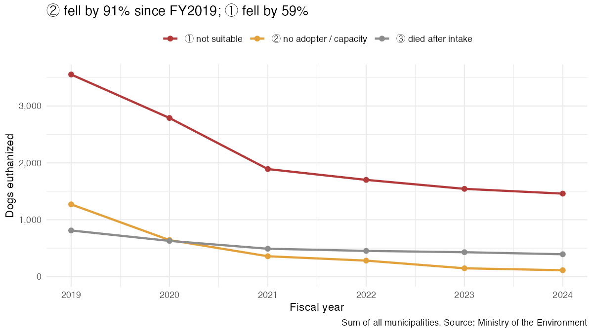
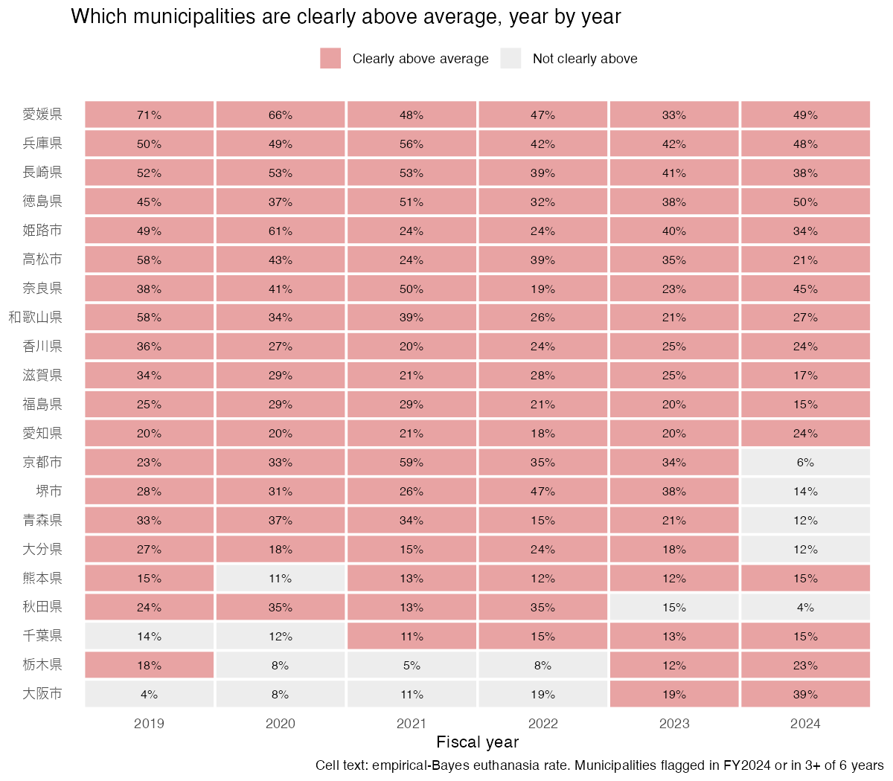

```{r}
#| label: setup
library(dplyr); library(readr); library(scales); library(here)
QUIET <- TRUE
source(here("R/04_stability.R"))
n19 <- nat |> filter(fiscal_year == 2019); n24 <- nat |> filter(fiscal_year == 2024)
n22 <- nat |> filter(fiscal_year == 2022)
vc_tot <- varcomp |> filter(outcome == "euthanized_total"); vc_1 <- varcomp |> filter(outcome == "euthanized_1")
d19 <- decomp_year |> filter(fiscal_year == 2019); d24 <- decomp_year |> filter(fiscal_year == 2024)
always <- flag24 |> filter(years_above == length(years))
pup_n <- puppies |> count(fiscal_year, name = "municipalities")
```

Reports 02 and 03 used one year (FY2024). This report adds the municipal tables for FY2019–2023 (the years in which euthanasia is split into categories ①②③) and asks whether the FY2024 findings are **persistent** or could be **one-year noise**.

Data: Ministry of the Environment, 動物愛護管理行政事務提要 (editions 令和2–7年版). Every year passes the same validation as FY2024: the municipal rows sum to the PDF total row, and the dog total equals the national series. `r length(all_years)` municipalities appear in all six years; `r length(new_core)` core cities were created during the period (`r paste(new_core, collapse = ", ")`), so the prefectures they belong to change composition in the year they split.

## 1. National trend by category



```{r}
#| label: tbl-nat
nat |>
  transmute(FY = fiscal_year, `Dogs taken in` = comma(intake),
            `①` = comma(e1), `②` = comma(e2), `③` = comma(e3),
            `① per intake` = percent(e1_rate, 0.1), `② per intake` = percent(e2_rate, 0.1)) |>
  knitr::kable(caption = "Dog euthanasia by category, all municipalities")
```

- **② ("no adopter / capacity") fell from `r comma(n19$e2)` to `r comma(n24$e2)` dogs (−`r percent(1 - n24$e2 / n19$e2, 1)`).** ① fell less (−`r percent(1 - n24$e1 / n19$e1, 1)`).
- **The ① rate per dog taken in has risen since FY2022** (`r percent(n22$e1_rate, 0.1)` → `r percent(n24$e1_rate, 0.1)`), while ② kept falling. This could reflect fewer adoptable dogs arriving, or dogs being classified as ① that earlier would have been ②; the data cannot tell these apart.

## 2. Are the same municipalities high every year?

Each year I refit the RQ2 beta-binomial model and flag municipalities whose 95% posterior interval lies above that year's average.

```{r}
#| label: tbl-yearly
yearly_fit |>
  transmute(FY = fiscal_year, `Average (μ)` = percent(mu, 0.1), `ρ` = round(rho, 3),
            `Clearly above` = n_above, `Clearly below` = n_below) |>
  knitr::kable(caption = "Yearly beta-binomial fits (dog euthanasia rate)")
```



- **`r nrow(always)` of the `r nrow(flag24)` municipalities flagged in FY2024 were flagged in every one of the six years**: `r paste(always$jurisdiction, collapse = ", ")`.
- Some municipalities improved: 京都市, 堺市, 青森県 and 大分県 were flagged in five years but not in FY2024. Others are newer: 大阪市 (flagged only in FY2023–2024) and 栃木県 (rising from 5–8% in FY2021–2022 to 23% in FY2024).
- Rankings are fairly stable from one year to the next: Spearman correlation of the EB rates between adjacent years is `r round(min(adjacent$spearman), 2)`–`r round(max(adjacent$spearman), 2)`.

## 3. Persistent difference or yearly noise?

A binomial mixed model separates a **persistent municipality effect** $u_i$ from a **year-specific deviation** $v_{it}$:

$$\operatorname{logit}(p_{it}) = \beta_t + u_i + v_{it}, \qquad u_i \sim N(0, \sigma_u^2),\ v_{it} \sim N(0, \sigma_v^2).$$

```{r}
#| label: tbl-vc
varcomp |>
  transmute(Outcome = recode(outcome, euthanized_total = "Total euthanasia", euthanized_1 = "Category ①"),
            `σ²_u (persistent)` = round(var_persistent, 2), `σ²_v (yearly)` = round(var_yearly, 2),
            `Share persistent` = percent(share_persistent, 1)) |>
  knitr::kable(caption = "Variance components on the logit scale (municipalities present in all six years)")
```

- **`r percent(vc_tot$share_persistent, 1)` of the between-municipality variation in total euthanasia, and `r percent(vc_1$share_persistent, 1)` for category ①, is persistent.** The differences found in FY2024 are not one-year chance.

## 4. Does ① always drive the differences?

```{r}
#| label: tbl-decomp-year
decomp_year |>
  transmute(FY = fiscal_year, `①` = percent(cat1, 1), `②` = percent(cat2, 1), `③` = percent(cat3, 1)) |>
  knitr::kable(caption = "Share of the between-municipality variance in euthanasia rate, by category")
```

- **Not always.** ① explained `r percent(d19$cat1, 1)` in FY2019 and `r percent(d24$cat1, 1)` in FY2024; ② explained `r percent(d19$cat2, 1)` in FY2019. The RQ4 finding "① drives the differences" is true of recent years, and it became true as ② disappeared.

## 5. Puppies under ①

```{r}
#| label: tbl-pup
puppies |>
  group_by(fiscal_year) |>
  summarise(`Municipalities` = n(), `Puppies under ①` = sum(euthanized_1_young),
            `Top 3` = paste0(head(jurisdiction, 3), " ", head(euthanized_1_young, 3), collapse = ", ")) |>
  rename(FY = fiscal_year) |>
  knitr::kable(caption = "Puppies euthanized under category ①")
```

- In FY2024, only 3 prefectures reported puppies under ①. In FY2019 there were `r pup_n$municipalities[pup_n$fiscal_year == 2019]` municipalities. **徳島県 reports the most every year, and 長崎県 and 愛媛県 report some every year.** 広島県 reported many until FY2023 and none in FY2024.

## Summary

| FY2024 finding (reports 02–03) | Holds over FY2019–2024? |
|---|---|
| A group of municipalities has a clearly higher euthanasia rate | **Yes.** 12 of 16 every year; ~88% of variation is persistent |
| ① explains most of the difference | **Recently.** 56% in FY2019, 89% in FY2024 |
| Puppies under ① concentrated in 徳島・長崎・愛媛 | **Partly.** 徳島・長崎・愛媛 every year, but many more municipalities in earlier years |

## Limitations

- Counts are what each municipality reports; definitions of ① and ② may be applied differently between municipalities and over time.
- When a city becomes a core city, its dogs move out of the prefecture's figures (茨城県, 長野県, 愛知県, 大阪府 in this period).
- Dogs refused at intake are not counted anywhere.
